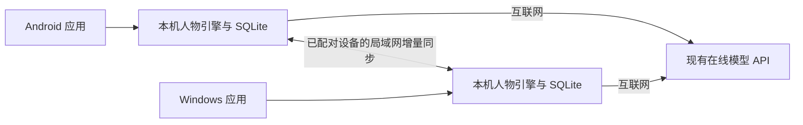

# Android／Windows 独立运行与局域网同步计划

日期：2026-11-07。状态：规划草案，尚未实施。

已确认：第一版沿用现有在线模型 API。手机无需连接电脑即可使用，但生成模型回复仍需要互联网；蜂窝网络可以承担这部分连接。局域网只用于设备间同步。

## 1. 产品目标

交付 Android 安装包和 Windows 安装程序。每台设备都有自己的角色运行逻辑、数据库和界面，电脑关闭时手机仍能聊天、保存、检索已有记忆；手机不在附近时电脑也能使用。

两台已配对设备在局域网可达时交换新增记录，离开局域网后各自继续，下一次连接再同步。不需要公网服务器、端口映射、Docker 或用户手动安装 Python/Conda/Node。

“手机独立”与“完全离线”分开：无互联网时仍能查看记录、管理本机资料与保存草稿，模型请求显示等待网络或明确失败，不伪造回复。完全在手机上运行大模型不属于首版。

第一阶段按 Android＋Windows、一个用户、一个角色、两台设备规划，不同时扩展 iOS、多人账号或多个消息平台。

## 2. 技术路线建议

### 优先复用现有逻辑，先用真机证明可行

推荐先提取一份与平台无关的 Python 人物引擎，复用 React 界面与既有业务规则：

| 部分 | Android | Windows |
|---|---|---|
| 安装与平台能力 | Kotlin 应用，处理生命周期、通知、权限和后台任务 | 桌面应用窗口、托盘、安装与更新 |
| 角色与记忆逻辑 | 通过 Chaquopy 嵌入共享 Python 引擎 | 打包同一份 Python 引擎 |
| 界面 | 本地 WebView 加载打包后的 React／Live2D | 优先评估 pywebview＋React／Live2D |
| 权威存储 | SQLite＋应用私有附件目录 | SQLite＋用户应用数据目录 |
| 模型 | 本机引擎经模型适配器调用在线 API | 相同业务接口与测试样例 |

这是两个在各自设备执行逻辑的应用，界面使用 WebView 不代表需要连接电脑上的网页服务。界面通过有限的本地桥接命令访问引擎，不直接执行任意 Python、SQL 或文件路径。

Chaquopy 支持在 Android 应用中嵌入 Python，但其 Android 二进制依赖不能假定与电脑上的 wheel 相同。因此先验证流式模型、取消、SQLite、语音、Live2D 与目标真机；不直接把当前 `requirements.txt` 整份塞进 APK。参考 [Chaquopy 文档](https://chaquo.com/chaquopy/doc/current/android.html)及[包兼容说明](https://chaquo.com/chaquopy/doc/current/faq.html)。Windows 打包路径参考 [pywebview freezing](https://pywebview.flowrl.com/guide/freezing)。

若 Python 嵌入在必要依赖、包体或生命周期上达不到验收，再评估 Tauri 2＋共享 Rust 核心。Tauri 有移动端和 SQLite 支持，但切换意味着移植人物逻辑，不是直接复用现有 Python 后端；不在真机验证之前启动整套重写。参考 [Tauri 概述](https://v2.tauri.app/start/)、[SQLite 插件](https://v2.tauri.app/plugin/sql/)和[原生移动插件](https://v2.tauri.app/develop/plugins/develop-mobile/)。

### 对当前项目的改造

- 保留场景规则、提示词组织、推理内容隔离、活动规则、消息稳定标识、记忆来源与取消协议，作为共享核心与兼容性测试的基础。
- 将模型传输、存储、时钟、文件路径、通知和任务调度抽为接口；人物引擎不再在模块导入时读写固定 `config/`，也不自行启动桌面专用服务。
- PostgreSQL／pgvector 改为可选旧版适配器，新安装版以 SQLite 为必需存储；Neo4j 不进入手机必需依赖。FastAPI 与容器版继续作为参考和回退入口。
- 优先验证现有模型 SDK 的 Android 依赖；必要时改用较薄的 HTTP／SSE 适配层，保持统一的流式、取消、错误和推理过滤契约。
- 音频由平台适配器执行。Android 系统 TTS 可作为首个可用方案，具体语言、音色和是否需要网络取决于引擎；现有在线 TTS 音色另作兼容验证，不承诺两端初版音色一致。字幕与可朗读内容仍共用过滤规则。
- 短期消息、工作记忆、状态、任务与活动逐步进入同一数据库事务体系；JSON 留作兼容导入／导出或缓存，避免两份数据同时充当最终依据。

长期记忆先做可移植的关键词检索与少量向量重排，验证中文检索质量与真机耗时。向量索引属于可重建缓存，不把 pgvector 或未经验证的原生扩展作为 Android 启动条件。

## 3. 同步的内容与边界

只把聊天列表复制过去还不够：人物的短期窗口、工作记忆和活动来源也需要接续。将“原始记录”“人物当前状态”“派生缓存”分开处理。

| 数据 | 首版策略 |
|---|---|
| 已提交用户消息、完整／中断的 AI 回复 | 按稳定 ID 增量同步，保留对话关系、来源设备与状态；不传每个流式 token |
| 人物基础设定与模型配置版本 | 同步可分享的设定与版本；并发编辑保留版本供选择 |
| 用户明确确认的场景、约定、材料和共同作品 | 同步带来源的操作与结果；冲突保留，不通过模型偷偷决定谁覆盖谁 |
| 短期与工作记忆 | 以当前选定的对话分支为依据重建，保留原消息引用 |
| 长期记忆 | 同步记忆内容、来源与编码版本；同来源重复编码可去重，矛盾信息保留证据 |
| 向量、检索索引、临时总结 | 可重建；不成为同步必须传输的大文件或唯一事实来源 |
| 语音缓存 | 默认不传，可重生成；同步旧消息不会触发补播 |
| 图片、共同资料等附件 | 按内容哈希引用，分块、断点续传；缺失时显示待同步 |
| 通知、声音、音量、勿扰、窗口布局 | 首版本机偏好，标明“仅本设备”；配对不能替另一端授予系统通知权限 |
| API 密钥、设备私钥、会话授权 | 不进入普通记录同步；分别保存在系统安全存储中 |
| 模型用量与已完成任务回执 | 同步用于核对，不因接收记录再次执行；额度先按设备限制 |

跨端同步结束不立即触发模型总结、再次生成回复或自动播放。需要重建的派生记忆排入受限任务，避免同步反过来产生无限新消息与费用。

两端断开时无法保证一个即时共享的总额度。首版明确显示各设备预算和截至上次同步的汇总；如要总额上限，可提前分配各端额度，不把断开的两端都当作仍有完整共享余额。

## 4. 两端分别聊天后的处理

推荐采用“记录可汇合，当前经历有明确接续点”的方案，首版不做全自动的人物状态融合。

- 如果另一端没有新的实际对话或活动，直接接续新增记录，不提示冲突。
- 如果两端从同一个接续点分别产生了回复／活动，保留两个可追溯段落。同步界面显示“手机新增几条、电脑新增几条”，用户选择接着哪一段继续。
- 未选段落仍可查看、收藏和引用；模型当前上下文使用选定段落，旁支内容必须带来源，不能把两套互斥经历都当作同一条已发生的故事。
- 不把 PAD 数字平均，也不按设备系统时间较新就覆盖场景和目标。对用户明确事实的矛盾保留出处，必要时请求确认。
- 相同消息 ID 的相同记录只接收一次；相同 ID 但内容不同进入冲突区，不覆盖。

例如，手机端正在讨论食堂里的事，电脑端未与手机同步时继续了一段图书馆对话，汇合后两段记录都在。接着哪段聊由用户决定，程序不会擅自把角色改成“刚从食堂瞬间到了图书馆”。这里未同步不代表没有互联网，两端仍通过各自网络调用模型 API。

为了减少日常分叉，默认手机承担后台主动陪伴，电脑在用户使用时互动；电脑后台默认不独立持续生成另一条人物生活。同网切换设备时先同步、完成当前轮次，再交接接续点。另一端不可达时本机仍可继续，后续按分支处理；不能把没有中心协调的断网租约当作全局唯一运行权。

纯粹的空闲推演作为带时间和依据的本机推测保存，避免每次心跳都制造一条必须合并的事实。真正发出的消息、确认过的场景与已提交活动才成为需要同步的正式记录。

## 5. 增量同步协议

现有 `message_id` 可以保留，数据库自增 ID 只作本机索引。旧 `legacy-*` 标识增加来源命名空间和别名映射，避免两台独立数据库的 `legacy-1` 相撞，并保持记忆与收藏引用有效。

现有 `epoch` 每次启动／读档会变化，只适合实时连接，不能充当永久世界标识。新增持久 `world_id`、对话／分支 ID、设备 ID 和操作 ID；每个设备在每个世界内有独立递增序号及因果父节点。现实时间用于展示，不单独决定先后与冲突胜者。

基本流程：

1. 交换协议、数据格式、世界和设备身份，检查是否兼容。
2. 交换双方对每个来源设备已连续确认的序号，找出缺失操作。
3. 分批传输、验证、事务落库，再确认游标；中断后从已确认位置继续。
4. 依赖缺失时暂存，不越过缺口宣称完成；相同操作反复到达没有重复效果。
5. 原始记录就绪后重建当前分支的读取视图，展示同步摘要和需处理的冲突。

业务写入与同步发件箱记录放在同一 SQLite 事务中。接收操作同样事务去重，不直接交换运行中的整个数据库文件。首次全量同步使用一致性快照与后续增量，附件另行核对。

流式片段可以在本机检查点保存，进程中断后标为未完成；跨端只同步明确提交的终态。模型超时或进程被杀时保留请求回执状态，不因为同步或恢复就自动重复收费请求。

删除需要同步墓碑，不能仅把本机那一行抹掉，否则旧设备重连会让记录复活。首版保留操作与墓碑，先不做激进清理；压缩策略另设版本与确认条件。协议升级不兼容时停止写入并提示升级。

## 6. 发现、配对与局域网体验

首次进入“设备同步”，由电脑显示一次性配对二维码，手机扫码并确认设备身份。二维码携带临时邀请、连接信息与身份指纹，不携带明文模型密钥。后续通过已配对设备身份建立加密连接。

配对后使用 mDNS／Android NSD 发现设备，支持 IP 变化；提供二维码或手动地址作为发现失败时的备用入口。局域网发现依据 [Android NSD](https://developer.android.com/develop/connectivity/wifi/use-nsd)，权限按实际目标 SDK 和[局域网访问规则](https://developer.android.com/privacy-and-security/local-network-permission)实现。

电脑优先提供同步监听端，手机前台主动连接，减少对 Android 长时间后台监听的依赖。两端打开且可达时可自动同步，也保留“立即同步”。手机后台自动发现和同步以系统实际允许为准。

界面至少显示：已配对设备、最近成功时间、本机待同步条数、对方是否在线、进度和冲突。相同 Wi-Fi 不保证互相可达：访客网络隔离、防火墙或权限拒绝时显示具体原因，保留本机数据和手动重试。

配对不信任同网任意设备，传输验证设备身份与数据完整性。失去或撤销设备后拒绝后续连接；应用设置与模型工具不能借同步接口执行任意文件操作。首版没有公网监听或自动端口映射。

## 7. 手机后台与“活着”的实现

前台采用事件驱动与低成本时钟检查；只有真正需要状态推演、回复或记忆整理时调用模型。后台由 Android 原生调度器承担短任务，状态与待办落库，系统回收后可以继续恢复。

不能承诺屏幕关闭后永久每十秒联网推演。Android Doze 会延迟后台网络和任务，WorkManager 周期任务的最小间隔为 15 分钟，实际执行还受系统约束影响。参考 [后台任务调度](https://developer.android.com/develop/background-work/background-tasks/persistent/getting-started/define-work)与 [Doze](https://developer.android.com/training/monitoring-device-state/doze-standby)。

推荐首版：前台正常陪伴；后台按较长窗口尝试有限推演与本机通知，过时事项合并为回顾；回到前台先校准经过时间，不伪造用户离线经历。是否增加用户主动开启的常驻模式，需要先验证相应平台能力、通知与续航，不能当作无条件保活方案。

系统回收、普通切后台、用户强行停止、无网络和重启分别测试，不把“曾在后台成功一次”视为长期运行保证。明确提醒与不确定的角色主动关心也使用不同提示，不能假装系统保证准点执行所有人物活动。

## 8. 数据迁移、存档与回退

先从旧版本的一致性备份／存档读取，导入独立 SQLite，核对消息、状态、活动、记忆来源和附件；不清空 PostgreSQL、不修改原世界文件。

短期窗口与工作记忆根据选定对话来源恢复，不仅验证手机聊天列表能看见，还要验证下一轮模型实际获得已同步内容。丢失的来源、附件和旧时代未知时间都必须保持可见的缺失状态。

游戏读档创建新的世界分支／接续点，不回退同步序号、设备配对、已完成任务回执与本机隐私偏好。旧 `.ember` 保留导入兼容路径；新同步数据不能让另一台设备自动撤销现实操作或重新播放历史语音。

新安装版与旧容器版使用不同数据目录，先并行试用。确认迁移正确后再切换日常使用；回退可以连接保留的旧世界，但新版本后来产生的记录需要经过导出／兼容导入才能回流，不能声称自动回退也会带回全部新数据。

## 9. 分阶段交付与验收

| 阶段 | 交付 | 通过条件 |
|---|---|---|
| P0：真机小样与协议约定 | 极简 APK，运行现有核心的一条完整对话；定义稳定身份、事件与分支字段 | 电脑关闭，用手机移动网络完成连续三轮；流式、取消、SQLite、重启恢复通过；检查 WebView/Live2D、TTS、包体和依赖，决定 Python 嵌入路线是否继续 |
| P1：共享核心与 SQLite | 平台接口、数据库迁移、消息/状态/任务事务及同步操作日志；Windows 可运行原型 | 核心回归能在临时 SQLite 执行；角色、三层记忆和共同活动可继续；不需要 Docker 启动 |
| P2：独立双端安装版 | Android APK 和 Windows 安装包，各自运行与保存 | 分别关掉另一端仍能聊天；无网查看与失败恢复明确；语音、权限和升级不损坏本机数据 |
| P3：双端局域网同步 | 安全配对、增量传输、冲突接续、附件与删除传播 | 两边各产生记录后汇合，零丢失/不重复；中断恢复；下一轮上下文能接续选定记录；历史同步不触发回复或声音 |
| P4：后台陪伴与试用 | 原生后台任务、本机通知、预算和长期恢复 | 实测锁屏、系统回收、重启、Doze、跨日、重复发现及手机续航；5–7 天实际使用记录；按机型报告能力边界 |

每轮交付可运行的小版本，不先开发两套不同的人物业务逻辑。P0 若不通过先调整技术路线，不把完整双端重写当成验证方案。

同步至少覆盖：单端新增、双端新增、相同 ID、ID 内容冲突、两个设备时钟不准、流式中断、重复投递、接收后崩溃、删除后旧端重连、分支读档、设备撤销、格式升级、来源引用、附件缺失与大批历史。所有自动测试使用合成记录和独立数据库。

## 10. 本轮范围

只制定计划与核对技术依据，没有新增 Android/Windows 应用、修改数据库或迁移真实聊天。原有容器服务、启动脚本和数据继续保留。

下一次进入实现时，先做 P0：确定用于验证的 Android 真机与系统版本，做出电脑关闭后可以独立完成三轮对话并恢复本机历史的 APK，再扩大到双端完整同步。
