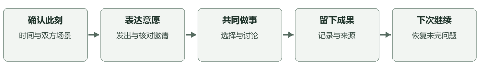
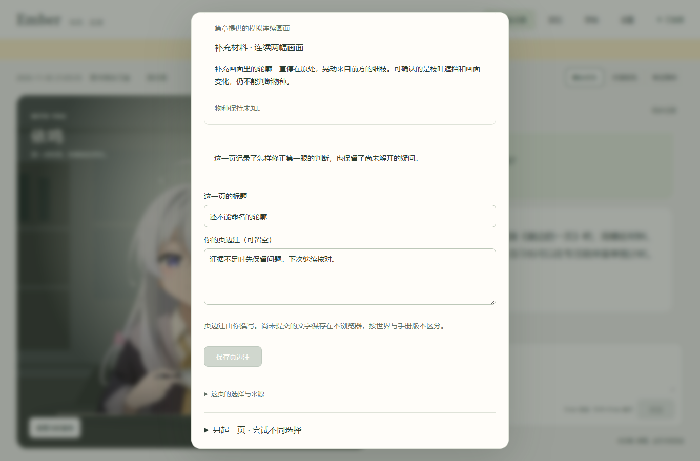
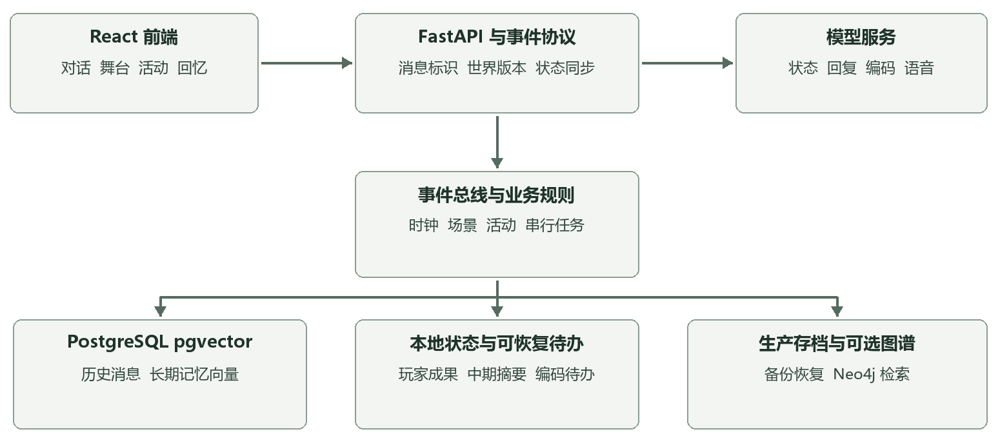

# Ember 中期项目策划案

持续角色陪伴与共同活动

项目中期评审材料　2026 年 11 月 2 日

## 01 项目定位与中期结论

Ember 是以单个虚构角色“依鸣”为入口的陪伴交互原型。项目要回答的问题是：用户结束一次聊天之后，是否还有一件愿意回来继续的小事；角色是否能依据时间、场景和已确认的共同记录接住这次返回。中期优先验证这个闭环，再决定是否扩大内容与部署规模。

现阶段的产品方向是“持续角色陪伴＋共同活动”。对话用于建立情境和表达意愿，活动规则负责推进选择和成果，记录系统负责让后续互动有据可依。依鸣具有校园生活背景，但不会因为界面显示图书馆，就推断用户也在那里。校园与角色均为虚构设定，不代表现实机构背书。

中期主线选择《窗边的一页》：用户发出邀请，核对已保存的回复，共同处理两份虚构观察材料，做出取舍，留下可编辑的一页成果，再通过回忆和存档继续。它是短共同项目原型，尚不是具有完整章节、地图和长期内容量的游戏。

| 评审关注点 | 本阶段交付 | 判定边界 |
|---|---|---|
| 能否操作 | React 界面与可运行展示包 | 展示台词预设，不证明模型理解 |
| 是否有共同活动 | 生产规则驱动的手册和自习 | 手册为虚构资料推演 |
| 能否延续 | 来源记录、成果、历史和存档 | 当前仍依赖本地进程 |
| 是否可信 | 事实与推演区分、错误可见 | 仍有模型理解与编造风险 |

本阶段的工程闭环已较完整，玩法厚度和角色自然度仍需验证。下一阶段应先观察用户能否独立完成活动、能否说清共同发生过什么、是否愿意回来继续，再投入全天候服务和更多角色。

阅读顺序建议：先看产品与玩法，再看交互、记忆和架构；第八节说明验证证据及其局限，最后两节给出阶段计划与交付方式。本文是项目方案与完成情况说明，不包含未经实施的用户研究结论或市场规模判断。

## 02 用户需求与体验循环

目标用户假设是愿意进行低压力文字陪伴、能接受虚构角色，并希望在学习间隙共同做一点事的人。具体年龄、付费意愿和使用频率尚未验证；不能把开发者自己的体验推定为所有用户的需要。首轮研究应同时覆盖熟悉陪伴产品、熟悉视觉小说和较少接触这类产品的人。

目前最需要解决的体验问题是距离感和无事可做。仅有流畅回复并不足以建立连续相处：用户还需要知道双方此刻在哪里、角色在做什么、刚才的约定是否成立，以及离开以后哪些进度仍然保留。界面应把这些信息变成可核对的记录，而不是让用户猜测后台是否工作。

单次体验以三至八分钟为设计目标：进入情境，表达邀请，做一次选择，留下成果或暂停。此时间是后续内容设计目标，不是当前短项目的实测平均时长。分钟级的陪伴可以由真实自习计时承接；跨日体验则要由未完成项目和有来源的回顾承接，不能靠每日签到或催促制造返回理由。

一次体验应有明确的结束权。用户可以只聊天、只计时、拒绝邀请、暂停项目或保留未完成片段。角色不能以情绪惩罚、虚构失落或丢失成果逼迫用户在线。成长反馈首先来自共同完成的内容和判断变化，暂不设计付费抽取、体力消耗或亲密度刷取。

下一阶段拟验证三件事：用户能否不听主持人指点就开始并完成一页；能否区分用户确认、模型整理和推演；间隔一天后是否愿意主动打开并继续。访谈中的“愿意”仅是意向，实际返回需另行观察。

## 03 共同项目与游戏规则

《窗边的一页》把“共同做一件小事”落实为确定的规则。玩家先选择窗边速写或旧资料，再面对资料不完整的问题，选择补充核对、换一个观察角度或保留疑问。系统展示相应材料与结果，用户编辑标题和页边注，决定是否留下这一页。

| 环节 | 玩家输入 | 系统结果 |
|---|---|---|
| 邀请 | 发出邀请并核对回复来源 | 确认双方愿意共同试作 |
| 选材料 | 窗边速写或旧资料 | 获得第一张材料卡，消耗一步 |
| 做取舍 | 核对、换角度或保留疑问 | 改变证据与结论的表达 |
| 留成果 | 编辑标题和页边注 | 保存成果、选择和来源 |
| 离开 | 暂停或结束并保留片段 | 不擅自完成，不丢已有材料 |

当前有两条起始路线、每条三种后续取舍，共六条选择路径，归入三类成果表达。调查预算为三个规则步数，不是倒计时，不会因为用户阅读较慢而损失机会。不同路径应在材料、确定程度和成果文字上产生可见区别，而不只是更换一句角色评价。

模型可以讨论材料和表达角色态度，但不能通过一句话直接完成项目、补足证据或改变规则状态。正式推进必须通过经过校验的玩家操作。每次提交携带请求标识和项目版本，避免网络重试重复推进；世界暂停时不允许推进。

当前玩法的局限是内容短、重复体验价值有限，缺少跨日项目之间的联系。后续应先制作三种小项目模板：观察整理、共同学习和生活规划。每种都要具有不同信息约束、可暂停节点和可留下的成果，避免把所有活动换成同一套选择题。

关系变化先以“角色引用了哪次共同选择、如何改变后续建议”表现，不新增没有依据的亲密度数值。暂不扩充完整地图、多角色关系网或人格成长系统，以免在内容尚未成立时扩大维护范围。

## 04 人机交互与展示界面

主界面保留舞台优先、对话优先和专注陪伴三种布局。布局变化只改变信息密度，不改变世界位置或活动状态。主要入口是陪伴、一起做点事、回忆、存档与设置；共同活动不应埋在技术面板中。

上图为本次隔离展示运行截图。黄色标识说明预设台词和合成记忆边界。世界栏显示后端时间、角色位置和交流方式；对白区显示接收、生成、保存或失败反馈。源码默认真实模型模式不显示该展示标识。

输入框保留草稿，中文输入法选字不误发，支持换行和发送快捷键。生成中的等待、停止本轮和关闭声音分别对应不同操作；停止声音不等于停止模型。回复的供应商推理片段和工具载荷不会作为正常对白显示或发送到 TTS。

共同活动入口先填写邀请草稿，由用户决定是否发送；开始活动需要选择一条已完成、已保存的角色回复，并由用户核对确认。这个流程保证可追溯性，但步骤偏多，下一轮研究应记录用户是否理解来源选择，必要时设计可撤销的就地确认，继续保留证据约束。

历史查询失败应显示失败原因和重试，不能显示成空白记录；连接恢复后按稳定消息标识合并。声音服务失败不阻断文字阅读。后续交互改进优先处理任务发现、返回路径和错误恢复，再增加装饰动画。

## 05 成果与跨次陪伴

手册的价值是让一次交流留下可指向的对象。标题和页边注由用户编辑；材料、选择和邀请来源可以展开核对。用户再次回来时，角色应围绕未完成的疑问继续，而不是每次重新寒暄或凭空宣布已经共同外出。

当前玩家记录包括收藏、带来源的约定、真实自习计时和共同项目。收藏保留原句；约定允许日期与地点未知；个人计时不会自动升级为共同活动。自习按现实秒数累计，与世界时间加速分离，重启或读档后暂停，等待用户确认继续。

跨日内容的设计顺序应是先记录，再回顾，再邀请下一步。返回页优先展示未完成项目、上次留下的问题和用户已确认的安排；模型的推演单独标识，不混入已发生的共同经历。允许用户更正、取消或不继续，不以“角色一直等待”作为事实陈述。

后续准备三个样章，每章至少有一个可暂停节点、一处会改变后续内容的选择和一个可编辑成果。先用人工编写的材料与规则保证因果，再允许模型在受限范围内生成讨论和回顾。扩展前须验证前一章的选择能否被准确引用。

## 06 三层记忆与时空原则

短期、中期和长期记忆承担不同职责。短期用于接住当前对白，中期保留有来源的摘要和待处理事项，长期支持跨次检索。记住一段文本与正确理解它是两件事，三层管线工作也不能保证角色绝不误解。

| 层级 | 当前实现 | 使用约束 |
|---|---|---|
| 短期 | 最近 20 条消息，含新消息逻辑时间 | 旧消息未知时间不可直接当作今天 |
| 中期 | 来源缓冲与原文摘要，持久化待办 | 摘要引用须属于来源原文 |
| 长期 | pgvector 双向量及可选图谱 | 召回带来源与时间依据，降级可见 |

编码由消息数量、周期、活动结束和明确记忆请求等触发。整理结果先进入可恢复待办，再确认向量写入，避免一次失败丢失资料；工具召回后状态模型还要消费工具结果。图谱是可选补充，不能作为主要记忆是否成功的唯一证据。

后端世界时钟是当前时间的唯一来源，默认使用 Asia/Shanghai。正常启动跟随现实时间，读档回到存档时间；旧聊天和离线推演必须与当前事实分开。用户说过“明天见”，不能在数天后仍直接当作明天的安排。

场景记录角色位置、用户位置、交流方式和远程联系方式是否确认。明确移动、分开或见面之后才更新相应字段；未知保持未知。默认新相遇可面对面，旧状态迁移不能仅凭角色位置推定双方同处一地。

对话流程先接收带时间的输入，由状态模型更新并校验场景，提交状态，再生成角色回复、保存与语音。对话与空闲演化串行，读档等待当前任务结束并暂停新增任务。离线变化只能作为推演，不能补写用户经历或双方已完成的约定。

下一阶段重点评价来源正确率、相对时间误用、地点冲突和未知信息编造，而不是只评价回复是否温柔。过去抽查仍出现缺依据细节，因此策划上保留更正入口和低信心表达，不承诺完全消除模型错误。

## 07 技术架构与数据流程

前端通过 HTTP 获取配置、历史和玩家记录，通过 WebSocket 接收流式回复与事件。稳定消息标识用于合并实时消息和持久化记录；世界版本用于隔离读档前后的旧事件；语音与对应消息关联，避免恢复时重播旧声音。

FastAPI 后端由事件总线组织对话、状态和时钟。状态模型处理场景与 PAD 状态，回复模型生成对白，记忆整理与检索为上下文提供依据。PAD 是用于调节输出的数值状态，不是角色具有真实情绪或意识的证据。

生产消息与长期向量写入 PostgreSQL pgvector，图谱可选 Neo4j。历史读取和后台写入使用独立连接与事务，写入失败保留待办并有限重试，稳定标识防止重复。初始化先建立 vector 扩展再注册向量类型，认证或查询故障以明确错误呈现。

生产存档包含数据库和状态、短期与中期记忆、玩家体验及计时相关信息。恢复前等待任务、创建备份、恢复并核对必要部分、同步序列、更新世界版本；必要恢复失败不能宣称成功。退出或恢复后的自习等待用户继续。

展示模式复用界面、时钟、共同项目规则、玩家记录和事件协议，以 JSON 历史、JSON 快照和预设回复适配器替换外部服务。这能让评审稳定复现交互，但不能证明生产数据库迁移、真实向量召回或 TTS 当场成功。

## 08 完成情况与验证证据

| 项目 | 当前状态 | 证据范围 |
|---|---|---|
| 对话与交互 | 已实现 | 流式、草稿、取消、静音与错误恢复 |
| 共同项目 | 已实现短原型 | 两次选择、六路径、成果与来源 |
| 三层记忆 | 已实现管线 | 自动测试及历史隔离抽查 |
| 时空一致性 | 已有约束 | 仍存在模型理解与编造风险 |
| 常驻与移动端 | 后续规划 | 当前本机运行，无账号与公网鉴权 |
| 真人可用性研究 | 待执行 | 已有任务卡，无参与者结果 |

本次后端回归 241 项通过，使用隔离 PostgreSQL 测试端口与临时数据库，没有清空业务库。前端单元检查 26 项通过，构建与静态检查通过。构建仍有 Live2D 分块大于 500 KB 的提示；延迟加载已存在，但仍需关注低性能设备。

展示适配另行检查完整活动路径、保存恢复、刷新持久化和响应布局，详细执行结果随包提供《验收报告》。自动检查保证规则与协议的可复现性，不能代替用户是否觉得自然、有趣或愿意继续的判断。

此前曾在隔离数据中完成真实模型记忆抽查：两条长期记录写入向量，模型召回了合成的饮品偏好。该抽查只说明那次小样例路径成功，不代表本提交现场重新调用模型，也不代表所有长对话正确。此前角色自然度抽查仍产生过无来源细节。

已有历史前端验证包含 34 类浏览器检查和一次约 30 分钟、355 次合成回合的稳定性运行。它们针对当时版本，不等同于最新版本重新执行了长期压力测试；本次变更的验证范围以随包报告为准。

下一轮拟邀请 5 至 8 位参与者，使用匿名编号和合成场景，观察首次邀请、活动完成、来源理解、离开后恢复。记录是否独立成功、卡在哪一步、是否把预设或推演当事实。次日再观察实际返回行为，不编造留存率、满意度或实验结论。

## 09 后续迭代与验收门槛

后续按四个迭代推进，先解决体验闭环和内容，再决定是否投入常驻基础设施。每个迭代是建议工作单元，当前未指定团队人数与截止日期，因此不给出虚假的工期承诺。

| 迭代 | 主要工作 | 通过条件 |
|---|---|---|
| 一 体验验证 | 真人任务走查，改进活动发现与来源确认 | 至少 4/5 人无需提示完成主线；所有严重误解有记录与修正方案 |
| 二 连续内容 | 三个样章、返回回顾、跨日未完事项 | 间隔一天能恢复同一项目；引用选择有来源；未知不补造 |
| 三 常驻试点 | 服务端部署、手机网页、账号鉴权与任务调度 | 连续 72 小时受控运行；断线恢复、备份与费用上限可验证 |
| 四 表达扩展 | 按需语音输入、图片资料与场景表现 | 用户主动授权；输入失败可恢复；新能力不破坏旧记录 |

上述数字是拟定的验收门槛，不是已完成的研究成绩。若五名参与者中出现严重的来源误解，即使完成率达标也应先修正。若角色记忆错误频繁，先缩小可生成范围、加强引用和更正，再增加内容量。

共同内容的制作流程是：写明主题与事实边界，编写材料、选择和规则，覆盖全部路径，设计可暂停点，再为模型编写讨论约束，最后用真人走查验证。不能先让模型自由生成一整套经历，再试图靠提示词补救事实冲突。

角色“活人感”的改进集中在可观察的生活连续性：有限且一致的当前活动，有原因的注意力变化，记得用户确实确认过的事，允许不知道和暂停。暂不以增加内心独白、夸张情绪或频繁主动消息替代这些能力。

## 10 运行约束与提交方案

中期采用本地运行，外部模型和语音存在网络、认证与费用依赖。常驻试点前必须补齐服务端密钥隔离、用户鉴权、数据归属、调度与备份、清理和恢复机制。当前开发后端不应直接暴露到公网；手机浏览器入口也不能只靠把本地端口开放来完成。

| 风险 | 影响 | 下一步处理 |
|---|---|---|
| 模型编造与时间错用 | 削弱共同经历可信度 | 来源检查、未知字段、更正与回归样例 |
| 外部服务失败 | 无回复、无声音或无向量 | 超时、重试、降级和可见状态 |
| 内容不足 | 完成一页后缺少返回理由 | 先验证三个样章，再扩规模 |
| 素材授权不完整 | 影响公开分发与商业化 | 核验既有 Live2D 来源，必要时替换 |
| 本机停止运行 | 无法持续主动互动 | 受保护的常驻试点，明确在线状态 |

运行成本应按每轮大模型、小模型、Embedding 调用、语音、数据库和后台任务分别统计，用实际 token 与调用次数估算，并设置每日上限。当前不提供未经测量的单用户月成本或固定价格。对外服务前还需提供数据导出、删除与恢复边界说明。

提交包包含 Word/PDF 策划案、可运行展示入口、源代码、约七分钟讲稿、真实模式运行说明、素材说明、验收报告和 SHA256 文件清单。Python 与 Node 运行时不随包分发；展示首次准备依赖需要网络，准备完成后不需要模型或数据库。

回退以隔离为基础：展示数据位于 demo/runtime，真实抽查使用独立解压目录和专用数据库；停止展示进程后回到原项目即可。任何操作均不要求删除业务数据库卷。展示快照不能当作生产存档导入。

本文依据仓库功能基线 e9634bc8，以及本次展示适配与检查整理。主要内部依据是 product-direction-2026-11、shared-project-prototype、memory-pipeline-repair、world-protocol 和 usability-study 文档。第三方模型与渲染资源沿用仓库，授权来源仍须补齐；校园设定不代表现实机构背书。
