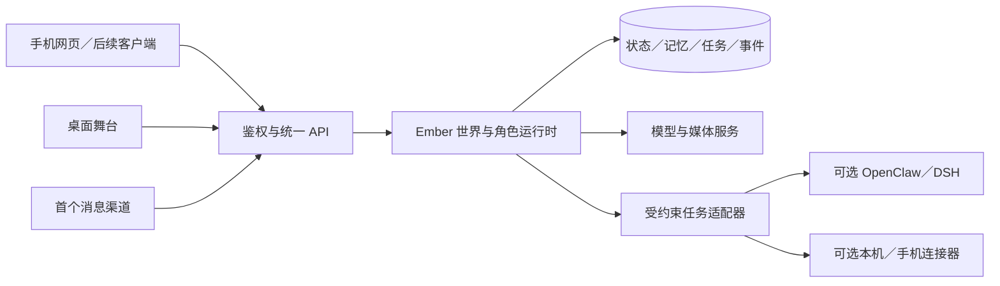

# Ember 下一阶段产品方向与开发计划

日期：2026-11-02。状态：已选“持续角色陪伴＋共同活动”为主线；首个[共同手册规则原型](shared-project-prototype.md)已实现。常驻部署及其他阶段尚未实现；迭代 A 的真人可玩性验收仍待执行。

2026-11-03 进展：已补齐[共同注意与返回衔接](continuity-second-pass.md)，包括有消息来源的共同文字材料、“接着上次”入口和交谈长间隔后的用户位置失效。此项支撑跨日连续性，不等同于完成常驻部署或真人可玩性验收。

依据：当前源码、已完成的交互改造，以及用户希望加强游戏性、持续运行和交互方式的反馈。用户描述的“大肥鱼”为基于 DeepSeek、以备用手机承载的自主 Agent；具体发行版本尚未确认，不把同名桌宠或某段演示当成该产品的全部能力。本文的定位与验收阈值是设计假设，需要真实使用验证。

## 1. 推荐方向与产品承诺

主线：**可以持续联系、具有自身生活、能与玩家共同完成事情的 AI 角色。**

以“依鸣的校园生活与共同项目”为首个产品，而非同时建设通用自动化平台、开放世界和多角色社交网络。AI 对话服务角色表达与自由互动；明确的规则和状态承载选择、过程、后果与完成结果。

玩家的第一项长期价值应当是：出门后仍能找到同一个角色，几天后回来能继续一件确实做过的事情，并看到双方共同留下的作品或经历。

| 路线 | 用户为什么打开 | 当前基础 | 主要新增投入 | 判断 |
|---|---|---|---|---|
| 通用个人 Agent | 替我完成工作 | 工具接口、对话、记忆 | 大量集成、执行可靠性、设备适配和维护 | 可接入成熟执行器，暂不作为主产品 |
| 完整生活模拟游戏 | 探索、经营、解锁内容 | 场景、时间、角色、存档 | 规则设计、内容产能、美术、编辑器 | 先验证小篇章，再决定扩展 |
| 持续角色陪伴＋共同活动 | 联系她、一起做事、延续关系与故事 | 人设、记忆、时间场景、活动及回忆 | 持续运行、跨端、活动规则、角色表现 | 推荐主线 |

首版只面向个人使用与小规模邀请测试。多人公开服务属于后续产品阶段，需要独立身份、数据隔离、配额和运营能力。

## 2. 当前工程已经解决什么，仍缺什么

已具备：流式对话、长期记忆、时空约束、Live2D/TTS、稳定消息标识、停止生成、三种视图、自习活动、来源可查的收藏/约定、读档恢复与事件纪元。

仍需建设：

- **可玩的规则。** 当前自习有计时与记录，但缺少可选择的策略、过程中的变化，以及能影响后续活动的结果。单独增加计时、好感值或奖励数量不能证明有趣。
- **可交付的持续运行。** `docker-compose.yml` 目前主要承载数据库；Python 后端依赖本机进程。把端口转发出去不能代替服务管理、鉴权、任务恢复与备份。
- **跨进程的世界事实。** `core/world_protocol.py` 的事件尾部最多 512 条，存于内存；`operation_lock` 是进程内锁。它们支持当前单进程恢复协议，不能直接当作跨进程持久队列或多实例互斥。
- **稳定的自主工作。** 当前 `system.tick` 驱动闲置状态模型。长期在线需要区分规则推进、需要表达的事件、待执行动作，避免无人使用时持续调用模型。
- **移动入口。** React 已有窄屏布局，但仍缺配对登录、移动端稳定会话、媒体输入和通知交付。
- **内容生产。** 目前有三个场景和表情白名单；可玩篇章还需要事件、活动、动作资产、音效及编辑预览，不能全靠临时生成。

保留现有 Python 引擎、React 和 Live2D，先将其组织成可持续运行的产品。等地图、碰撞与场景编辑成为真实需求时，再评估独立二维游戏引擎。

## 3. 第一段值得制作的体验

建议制作“共同完成一册校园观察手册”的试验篇章，题材可在验证后替换。依鸣现有人设中的校园、技术与观鸟兴趣能提供内容基础。

### 核心循环

发现一个机会 → 讨论并选择目标 → 准备与执行活动 → 面对一次有意义的变化 → 整理成果 → 后续生活引用这段经历。

第一份可玩样片只需要 20–30 分钟和一个完整结果。扩展篇章再支持跨 3–7 天继续，不要求每天签到，不因离开而扣关系或销毁机会。

例子：

1. 玩家选择做观察册、阅读小刊或整理校园路线，并能自由提出修改。
2. 在有限的虚构世界时间内，选择先找资料、去某处观察，或回去整理。选择影响可获取的线索和成品内容。
3. 活动中出现资料矛盾、路线暂不可用或角色疲惫等预先有规则的变化；玩家决定调整、求证、继续或结束。
4. 依鸣依据自己的目标和状态表达偏好、提出替代安排，玩家也可以拒绝。可执行选项和约束仍由程序检查。
5. 双方整理出一页手册，保留选择、引用和修订记录。未来可继续补页、改变主题或回看不同版本。

这属于虚构校园中的活动。用户现实外出、拍照和学习成果只能来自用户明确输入或授权数据；角色独自发生的虚构事件必须与双方共同经历区分。若引用真实鸟类知识或现实天气，保留外部来源，不凭角色台词确认为事实。

### 规则与模型的分工

| 程序确定 | 模型生成 |
|---|---|
| 活动阶段、剩余资源、地点可达性、线索获得条件、事件资格、完成/失败/中断 | 对话、偏好表达、同一事件的语言变化、对实际结果的回顾 |
| 用户选择是否有效、承诺是否确认、物品是否实际获得 | 建议候选行动；候选仍需通过规则校验 |
| 已发生事实与来源、成品状态 | 成品草稿和润色；不凭文本给玩家发奖或改写状态 |

初版规模控制为 3 个场景、3 类活动、约 6–8 个事件模板、1 个可编辑成果册和 2–3 种有差异的收尾。变化主要通过角色关系中的具体偏好、后续事件和作品表现，不先公开一条可刷取的好感条。

## 4. 持续存在与自主行动

持续存在包含三件不同的事：后台在线、世界能持续推进、行动能实际完成。三者分别验收。

### 角色日常

- 日程、地点切换、休息等采用规则或预先规划的有限状态推进。
- 模型在用户互动、约定触发、重要事件或有限主动表达时介入；心跳本身不等于一次模型请求。
- 用户离线时，角色可发生自己的虚构生活，不制造用户已经参与的活动。
- 主动联系由用户选择频率与时段；过时事件合并为一份回顾，不在重连后集中刷屏。
- 无人参与的变化要能被回看，也要为玩家保留介入和协商的空间。

### 行动执行

先提供三类与陪伴有关的工具：核对用户给出的资料、管理经确认的提醒、整理共同文档。之后才评估更通用的设备操作。

行动经过“提议 → 条件/权限检查 → 执行 → 工具回执 → 状态提交 → 角色汇报”。失败时保留失败或待确认状态，不能只生成“我已经做好了”的台词。

OpenClaw 或 DSH 可以作为可替换的外部执行器。Ember 维护人物、世界和交互，适配器把受约束任务交给执行器，并接收结构化结果；不同时运行两个会独立修改同一份记忆与场景的角色中枢。先以一个有明确输入输出的工具验证集成，而非直接迁移整个后端。

## 5. 部署与设备路线

推荐第一阶段使用**常驻 Linux 服务＋手机网页入口**。服务器可以是远端主机或始终开机的家用设备；用户自己的主电脑可以关机。没有一直在线的计算设备，后台就不能继续执行。

手机先承担随身入口、麦克风、拍照和通知。之后若确有手机操作需求，再添加 Android 设备连接器。

备用手机独立承载全部服务保留为可选路线，需要在具体设备上验证系统后台限制、资源占用、备份、系统更新和断网恢复。现有 Python＋pgvector 结构直接装进手机，维护成本需要实测，不能以能启动等同于能长期稳定运行。

第一版保持一个角色世界由单一写入者推进。不要直接增加 Uvicorn worker 数量，否则可能重复启动心跳、产生并行角色状态。先将持久任务和角色运行循环抽为可恢复的工作单元，再考虑扩容。

### 上线前必须完成的工程

1. 后端容器化、固定启动配置、依赖就绪检查、进程自动重启与优雅停止；前端使用生产构建。
2. 设备配对/登录、HTTP 和 WebSocket 鉴权、允许的来源、TLS；数据库不暴露到公网。当前本地管理与存档接口不能裸露上线。
3. 将角色状态、短期记忆、玩家记录与任务统一纳入持久化方案。可先保留经过备份的文件存储；迁移 PostgreSQL 时要做版本化迁移与可回退验证。
4. 在 PostgreSQL 保存到期任务、执行状态、重试时间、执行租约和投递记录。轻量阶段不必为此同时引入多种中间件。
5. 消息入站去重，任务/模型/语音取消关联，发出消息可确认。外部系统不支持幂等时，超时进入待核对，不盲目重试造成重复操作。
6. 规则/事实提交与待投递事件在事务中协调；事件尾部继续服务快速同步，但断电恢复依据持久状态与任务日志。
7. 计量模型、语音、后台推演和存储用量，设日预算及超预算降级；成本实测后再选机器与模型方案。
8. 备份到另一故障域，并在干净环境实测恢复。只复制同机文件不构成设备故障后的恢复方案。

### 读档与现实动作的边界

游戏存档可以恢复虚构世界，已发出的消息或已完成的现实操作无法一起撤销。外部操作回执、授权和投递账本保留于世界存档之外。

恢复存档后取消旧分支尚未执行的提醒；新分支中的现实提醒需重新确认。用世界分支、任务版本和稳定标识阻止旧任务执行或重复投递。用户身份和设备授权不随游戏读档回退。

加速时间只作用于虚构世界，现实提醒与服务调度采用现实时间。设备离线时显示能力不可用，云端角色仍可聊天，但不能声称已经操作离线设备。

## 6. 扩展交互的顺序

| 顺序 | 交互 | 完成定义 |
|---|---|---|
| 1 | 手机入口与语义活动动作 | 出门后可接续同一世界；选择活动有实际状态变化 |
| 2 | 按住说话＋可取消的语音回复 | 能处理识别错误、耳机/扬声器回声、打断与文字降级 |
| 3 | 传图讨论 | 仅分析用户选定图片，图像结论保留不确定性，可进入共同作品 |
| 4 | 角色表演 | 根据素材契约制作有限动作、表情和口型，与对白及活动同步 |
| 5 | 一个外部消息入口 | 双向消息有来源、回执和去重；遵守静默时段 |
| 6 | 小范围设备行动 | 连接器能力可查询，操作有授权和回执，断连可恢复 |

首个消息平台依据用户常用平台及其当前接入条件选择；不假设任意个人账号都能稳定自动化。不同时建设多个聊天平台、原生双端 App 和桌面壳。

## 7. 迭代顺序与验收门槛

以下按交付顺序组织，不作为承诺工期。制作内容与建立持续服务都需要；每轮控制范围，避免基础设施建设无限延期可玩性验证。

| 迭代 | 交付 | 验收 | 决策 |
|---|---|---|---|
| A：一段可玩的共同经历 | 利用现有程序制作一个完整短篇；约束规则、选择与成果 | 无开发者提示也能开始、做出至少两次有后果的选择、得到并找回成果；可中断 | 若只剩闲聊，先改循环，不扩地图 |
| B：关机后仍可联系 | 单用户常驻部署、手机入口、鉴权、持久任务与成本记录 | 主电脑关闭 72 小时仍可联系；模拟进程退出与网络失败后恢复；无重复提醒；备份可还原 | 达标后才扩大自动运行 |
| C：跨日的角色生活 | 一个小篇章、角色日程、有限主动联系、跨设备成果 | 间隔数天能继续；拒绝邀请和静默均有效；用户经历不被编造；读档不重复现实动作 | 用真实回访决定是否增加内容 |
| D：更自然的互动与有用行动 | 按住说话、传图，以及一个受约束工具 | 字幕/语音/状态一致；工具失败不报成功；可明确关闭 | 有明确使用收益才扩展工具或设备 |
| E：扩大产品 | 依据试用结果选择内容编辑器、原生手机端、桌面常驻或多人隔离中的一项 | 有重复使用理由与可承担的运行成本 | 不同时扩所有方向 |

建议下一个版本只承诺 A＋B 的最小范围：**手机随时能联系依鸣，能与她完成一个有过程和结果的小项目。** 先用已有文字、背景和少量角色表现走通，再投入大量新美术。

## 8. 如何判断方向成立

5–8 位真实试用者用于寻找问题，不用这个样本宣称市场规模或统计留存。先明确目标受众：愿意与固定角色保持联系、接受轻度生活模拟的人。

- **理解与完成：** 能否独立解释今天可以做什么、自己的选择改变了什么，并找到共同作品？
- **再次打开：** 间隔几天，是否主动回来继续；原因是角色、活动、作品还是开发者提醒？
- **角色连续性：** 换设备后能否接上同一件事；是否出现人设、时间、约定或记忆矛盾？
- **自主性价值：** 一次主动联系有没有帮助，是否过多；离线生活回顾是否值得看？
- **服务可靠性：** 消息和任务完成率、恢复耗时、重复投递、备份恢复及每个活跃用户的实际成本。
- **游戏质量：** 不依赖无限自由聊天时，活动本身是否仍有选择与变化；再次进行是否出现可理解的不同结果？

若用户只要陪伴，不喜欢规则约束，就降低任务门槛、加深角色生活与表现。若主要喜欢解决目标，则加强篇章、事件与成品。若主要需要现实自动化，再发展执行器集成。按实际偏好收敛路线，不能用更多功能代替判断。

## 9. 暂缓范围

全地图自由行走、多角色开放社交、复杂经济系统、自动公开发帖、全设备控制、长时间自我训练，以及单纯为增加可见状态而添加更多心理数值。

这些方向将显著增加内容、测试和维护负担。当前先验证核心承诺，再分别估算。

## 10. 资料与比较边界

- [OpenClaw 官方文档](https://docs.openclaw.ai/)：自托管 Gateway、消息渠道、会话与工具连接。它同样需要可用的运行主机；可以部署在本机或服务器。此处借鉴通道和执行能力，不据官网描述断言它在所有场景都成熟可靠。
- [DeepSeek Harness 官方项目](https://github.com/deepseek-ai/deepseek-harness/)：插件化 Agent 运行时。与用户所述手机形态相关的社区实现包括 [DSHA](https://github.com/DSH-APP/DSHA)；并未确认这就是用户所用版本，也未在用户设备上验证。
- [Spirit City: Lofi Sessions 官方商店页](https://store.steampowered.com/app/2113850/Spirit_City_Lofi_Sessions/)：将专注工具与精灵发现、收集和空间定制结合的参照。它说明陪伴工具可以具有明确的活动与反馈，不能证明同样机制适用于 Ember。

最初规划时只新增本文；选择主线后已实现上述活动原型。没有购买服务器、迁移业务数据库或接入外部账号。

## 11. 2026-11-04 进度：B 的本机基础验证

按照“先完成本机容器验证，部署设备稍后确定”的选择，已加入生产镜像、单世界锁、访问码与设备会话、手机网页入口、现实时间备份任务、用量预留与每日限制。身份、任务和额度使用独立 schema，不随游戏读档回退。

隔离合成栈已验证登录、设备撤销、会话与聊天材料持久化、进程正常重启和崩溃自动恢复。启动、备份和回退步骤见[常驻服务说明](service-deployment.md)。这属于 B 的基础交付；真实常开设备、TLS、实体手机、72 小时和异机灾备仍待验收，不能标为“关机后仍可联系”已完成。
